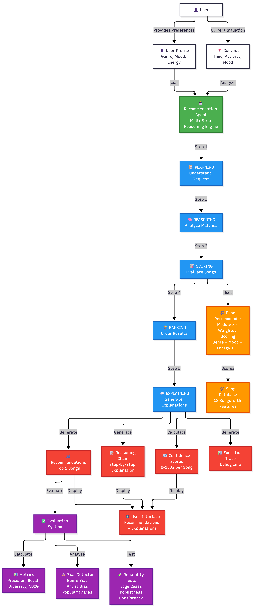

# 📊 System Architecture Diagrams

This directory contains Mermaid diagram source files for the Extended Music Recommender system.

## Overview

All diagrams are stored as `.mmd` (Mermaid Markdown) source files. These render automatically on GitHub and can be edited, previewed, and exported as PNG images.

## 📋 Diagrams

### 1. `architecture.mmd` - System Architecture

**Purpose:** Complete overview of the recommendation system architecture

**Shows:**
- User input (profile + context)
- Multi-step reasoning agent
- Agent pipeline (Planning → Reasoning → Scoring → Ranking → Explaining)
- Base recommender integration (Module 3)
- Evaluation system (metrics, bias detection, reliability testing)
- Output generation

**View:**
- On GitHub: Click `architecture.mmd` to see rendered diagram
- In Browser: https://mermaid.live (paste content)
- In VS Code: Install "Markdown Preview Mermaid Support" extension


### 2. `data-flow.mmd` - Data Flow Diagram

**Purpose:** Illustrates how data moves through the system

**Shows:**
- Input: User profile and context
- Processing stages with data transformations
- Base recommender interaction
- Output: Recommendations with reasoning
- Evaluation pipeline

**View:** Same as above

## 🛠️ How to Use These Files

### Viewing Diagrams

#### On GitHub (Easiest)
1. Push this directory to GitHub
2. Navigate to the `.mmd` file
3. GitHub renders it automatically
4. Click "Raw" to see source code

#### In VS Code
1. Install extension: "Markdown Preview Mermaid Support"
2. Open `.mmd` file
3. Right-click → "Open Preview"
4. Edit and preview in real-time

#### In Mermaid Live Editor
1. Go to https://mermaid.live
2. Open the `.mmd` file (drag & drop or copy content)
3. Edit and preview interactively
4. Export to PNG if needed

### Editing Diagrams

All `.mmd` files are plain text. Edit with any text editor:

```mmd
graph TD
    A["Node A"] --> B["Node B"]
    B --> C["Node C"]
```

Changes are reflected instantly in any Mermaid viewer.

### Exporting to PNG

**Option 1: Mermaid Live Editor**
1. Go to https://mermaid.live
2. Paste your `.mmd` content
3. Click the download icon (bottom right)
4. Choose PNG format
5. Save to `../assets/` folder

**Option 2: Command Line (requires npm)**
```bash
npm install -g mermaid-cli
mmdc -i architecture.mmd -o ../assets/architecture.png
mmdc -i data-flow.mmd -o ../assets/data-flow.png
```

**Option 3: Use VS Code Extension**
1. Right-click on `.mmd` file
2. Select "Export to PNG/SVG"

## 📁 Files Explained

| File | Type | Purpose | Audience |
|------|------|---------|----------|
| `architecture.mmd` | Source | Complete system design | Developers, architects |
| `data-flow.mmd` | Source | Process pipeline | Developers, engineers |
| This README | Doc | Diagram guide | Everyone |

## 🔄 Versioning

Since `.mmd` files are text-based:
- Version control with git works perfectly
- See full history of diagram changes
- Compare versions in git diff
- Branch diagrams for experiments

## 📐 Diagram Syntax

Common Mermaid syntax used in these files:

```mmd
%% Nodes
A["Rectangular"]
B{Decision}
C[rounded]
D[(Database)]

%% Connections
A --> B
B -->|Label| C
C -.-> D

%% Styling
classDef className fill:#color,stroke:#color,color:#fff
class A,B className
```

See [Mermaid Docs](https://mermaid.js.org/) for complete syntax.

## 📌 Important Notes

### Source Files Are Required
- ✅ Keep `.mmd` files in version control
- ✅ These are the authoritative source
- ⚠️ PNG exports are optional (for convenience only)
- ❌ Do NOT rely only on PNG files (they are static)

### When to Update Diagrams

Update diagrams when:
- [ ] Architecture changes
- [ ] New components are added
- [ ] Data flow is modified
- [ ] Evaluation system changes
- [ ] New modules are integrated

### GitHub Integration

- `.mmd` files render automatically
- No special setup needed
- Diagrams display in issue/PR descriptions too
- Can embed in README with markdown

Example in README:
```markdown


*Source: [diagrams/architecture.mmd](architecture.mmd)*
```

## 🎓 Learning Resources

- [Mermaid Official Docs](https://mermaid.js.org/)
- [Mermaid Examples Gallery](https://mermaid.live/edit)
- [GitHub Mermaid Support](https://docs.github.com/en/get-started/writing-on-github/working-with-advanced-formatting/creating-diagrams)

## 📊 Creating New Diagrams

To add a new diagram:

1. Create a new `.mmd` file in this directory
2. Write the diagram content
3. Preview in https://mermaid.live
4. Push to GitHub
5. Link in README files
6. (Optional) Export PNG to `../assets/`

Example:
```bash
touch components.mmd
# Edit with your editor
git add components.mmd
git commit -m "Add component diagram"
git push
```

## ✅ Checklist for New Diagrams

- [ ] File named clearly (e.g., `component.mmd`, not `diagram1.mmd`)
- [ ] Syntax is valid (preview in Mermaid Live Editor)
- [ ] Documented in this README
- [ ] Git-tracked
- [ ] Rendered correctly on GitHub
- [ ] (Optional) PNG exported to `../assets/`
- [ ] (Optional) Linked in main project README

## 🆘 Troubleshooting

| Problem | Solution |
|---------|----------|
| `.mmd` doesn't render on GitHub | Refresh page, check file extension is exactly `.mmd` |
| "Invalid diagram" error | Check syntax in Mermaid Live Editor |
| Can't edit `.mmd` file | It's a plain text file, use any text editor (VS Code, Notepad, etc.) |
| PNG export looks wrong | Check diagram renders correctly in Mermaid Live first |
| File won't push to git | Ensure file is in `diagrams/` folder, not in `.gitignore` |

## 📞 Support

For Mermaid-specific questions:
- Read [Mermaid Syntax Reference](https://mermaid.js.org/intro/syntax-reference.html)
- Try [Mermaid Live Editor](https://mermaid.live) to test syntax
- Check GitHub's [Creating Diagrams](https://docs.github.com/en/get-started/writing-on-github/working-with-advanced-formatting/creating-diagrams) guide

---

**Remember:** The `.mmd` source files are the "source of truth". PNG images are convenience copies only! ✨